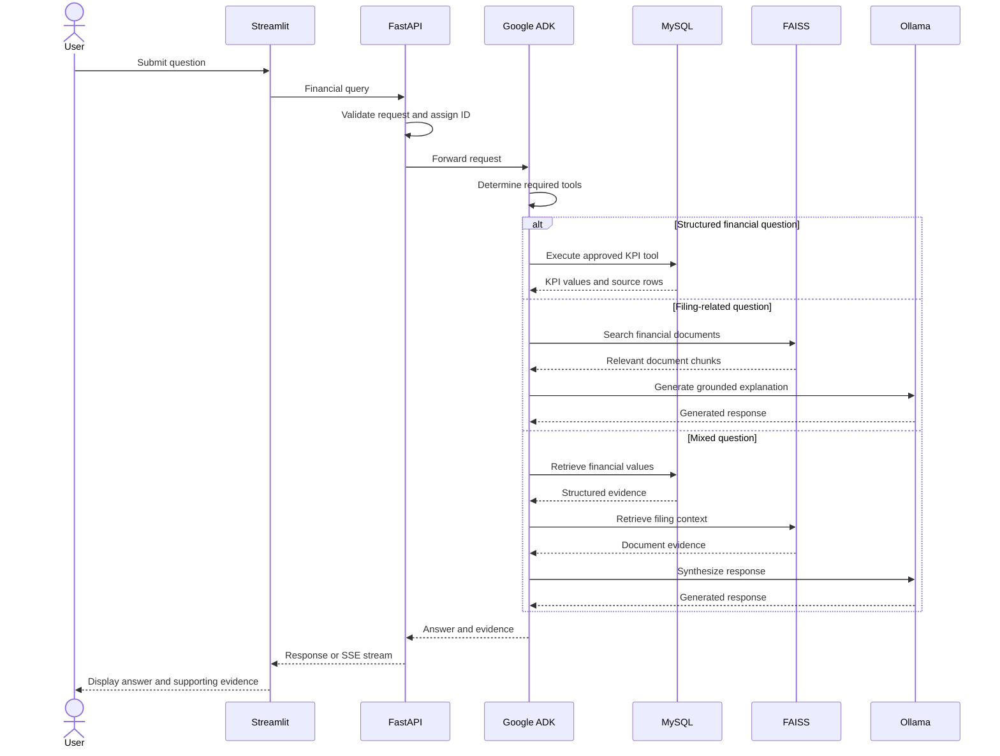

# CFO Copilot
## Level 1 Architecture & System Design Blueprint

**Project:** CFO Copilot on a Budget
**Category:** Self-Hosted Generative AI Financial Assistant
**Architecture:** FastAPI + Google ADK + MySQL + FAISS + Ollama + Streamlit

---

## 1. Executive Summary

CFO Copilot is a self-hosted AI-powered financial assistant designed to help users understand company financial statements, retrieve financial filing information, and answer KPI-related questions with supporting evidence.

The application combines structured financial data processing with Retrieval-Augmented Generation (RAG) and agent-based orchestration.

Unlike solutions that depend on hosted LLM inference, CFO Copilot uses a locally hosted open-weight language model through Ollama. This keeps inference within the application's controlled environment.

The system is designed around four principles:

1. Financial accuracy through deterministic calculations and source traceability.
2. Evidence-grounded answers through document retrieval.
3. Controlled AI orchestration through Google ADK.
4. Reliability through API validation, request handling, testing and security controls.

## 2. Problem Statement

Financial information is often distributed across structured statements, annual reports, quarterly filings and supporting documents.

Users need to:
- Retrieve financial KPIs for a company and reporting period.
- Understand financial performance and filing explanations.
- Compare reported values with supporting source information.
- Avoid answers based on missing, conflicting or unsupported data.

CFO Copilot addresses these requirements through a combination of relational data, semantic retrieval and locally hosted AI inference.

## 3. Technology Stack

| Layer | Technology | Purpose |
|---|---|---|
| User interface | Streamlit | Interactive financial assistant |
| API layer | FastAPI | Request handling and API endpoints |
| Agent orchestration | Google ADK | Intent routing and tool coordination |
| Language model | Ollama + local open-weight model | Local inference |
| Relational database | MySQL 8.0 | Financial records and KPI data |
| Vector retrieval | FAISS | Semantic document search |
| Embeddings | Sentence Transformers | Document and query embeddings |
| Backend language | Python | Application and business logic |
| Containerization | Docker Compose | Local service deployment |
| Testing | Pytest and ADK evaluation scripts | Functional and agent evaluation |

## 4. High-Level Architecture

The application follows a layered architecture.

### Presentation Layer
Streamlit provides the interface through which users submit financial questions and view answers.

### API Layer
FastAPI receives requests, validates inputs, assigns request IDs, manages request execution and exposes versioned endpoints.

### Agent Layer
Google ADK coordinates the agent workflow and selects the appropriate tools based on the question.

### Business Logic Layer
Financial calculations, KPI normalization, source resolution and validation are handled by Python services rather than delegated to the language model.

### Data Layer
MySQL stores structured financial information, while FAISS supports semantic retrieval over document chunks.

### Inference Layer
Ollama serves the locally configured open-weight model.

## 5. Request Processing Workflow

A request follows this general sequence:

1. The user submits a question through Streamlit.
2. The UI sends the request to FastAPI.
3. FastAPI validates the request and associates it with a request ID.
4. The agent determines which information sources are required.
5. Structured questions use approved financial data tools.
6. Filing-related questions use the document retrieval tool.
7. Mixed questions can use both structured and unstructured evidence.
8. The system constructs a response using the available evidence.
9. The API returns the response to the UI, with streaming support where applicable.

### Architecture Sequence Diagram

## 6. Agent Routing Strategy

The agent uses different tools depending on the information required.

| Question type | Expected processing |
|---|---|
| Structured KPI | Financial KPI tool |
| Filing explanation | Financial document retrieval |
| Mixed financial question | KPI tool and document retrieval |
| Unsupported or missing information | Withhold unsupported claims |
| Security-sensitive request | Apply security policy |

The architecture separates financial computation from language generation. The language model is not treated as the authoritative source of financial numbers.

## 7. Financial Data Architecture

MySQL stores the core financial data.

Important tables include:

- `companies`: Company metadata.
- `filings`: Filing and reporting-period information.
- `statement_lines`: Normalized financial statement records.
- `kpi_definitions`: KPI names, formulas and definitions.
- `kpi_values`: Calculated KPI values and provenance.
- `document_chunks`: Financial document chunks and content hashes.
- `chat_sessions`: Session metadata.
- `request_metrics`: Request and inference measurement fields.

### Data Integrity and Traceability

The database schema includes primary keys, foreign keys, unique constraints and indexes.

Calculated KPI records maintain:
- Company and reporting period.
- KPI identifier.
- Calculation status and confidence.
- Source row identifiers.
- Calculation version.

This supports traceability between a calculated financial result and its underlying records.

Missing inputs are represented explicitly instead of silently inventing financial values.

## 8. Retrieval-Augmented Generation

The RAG pipeline uses financial document chunks, embeddings and FAISS similarity search.

The retrieval workflow is:

1. Prepare financial document content.
2. Split documents into chunks.
3. Generate embeddings using Sentence Transformers.
4. Store searchable vectors in FAISS.
5. Embed the user's question.
6. Retrieve relevant document chunks.
7. Use retrieved evidence to support the answer.

The current retrieval evaluation reports:

| Metric | Reported result |
|---|---:|
| Documents | 77 |
| Chunks | 152 |
| Embedding dimension | 384 |
| Retrieval index | FAISS IndexFlatIP |
| Evaluation cases loaded | 21 |
| Cases scored | 18 |
| Recall@5 | 55.56% |
| MRR@5 | 0.3833 |
| Mean retrieval latency | 9.99 ms |
| P95 retrieval latency | 13.8 ms |

**Evaluation limitation:** These retrieval metrics use document metadata relevance as a proxy. They do not independently establish answer correctness or financial accuracy.

## 9. Local Model and Inference

The system uses Ollama for local inference.

The project evaluation artifacts include experiments with:
- Qwen 2.5 1.5B.
- Llama 3.2 1B.

The reported runtime configuration for the Qwen experiment includes:
- Quantization: Q4_K_M.
- Model size: approximately 1.2 GB.
- Active context configuration: 4096 tokens.
- Local model serving through Ollama.

Model selection should consider memory consumption, latency, tool-routing reliability, answer quality and refusal behavior.

No hosted LLM inference is required by the architecture.

## 10. API Reliability and Streaming

The API exposes versioned endpoints under `/api/v1`.

Reliability mechanisms implemented and covered by project tests include:
- Request validation.
- Request ID propagation.
- Standardized validation errors.
- Bounded concurrent request handling.
- Bounded queue handling.
- Service-busy responses with retry guidance.
- Server-Sent Events (SSE) streaming.
- No-cache response handling for streaming.

The queue tests verify that queued requests can proceed after an active request completes and that overloaded requests receive a 503 response with a Retry-After header.

## 11. Security Considerations

The system treats user input and retrieved document content as untrusted data.

Security design considerations include:
- Prompt-injection resistance.
- Restricted tool access.
- Avoiding disclosure of internal prompts and secrets.
- Avoiding unsupported financial claims.
- Separation of model inference from database credentials.
- Tenant-aware session and data access.
- Protection against unauthorized cross-tenant information access.

Security tests include prompt-injection scenarios and checks that malicious text does not replace supported deterministic KPI calculations.

Tenant isolation must be enforced and verified across every relevant database, session, retrieval and cache access path before production deployment.

## 12. Testing and Evaluation

The project includes automated tests and evaluation scripts for important application behaviors.

The available test artifacts cover:
- Financial unit normalization.
- KPI aliases and calculations.
- Amended filing handling.
- Year-over-year calculations.
- Missing financial input handling.
- API validation and error responses.
- Request ID propagation.
- Queue and overload behavior.
- Security scenarios.
- SSE streaming behavior.
- ADK agent routing and trajectory evaluation.
- Retrieval evaluation.

The evaluation scripts capture tool calls, tool responses, final answers and execution latency.

Routing metrics and security metrics are treated separately. A successful trajectory execution does not automatically prove that the final answer is correct.

## 13. Performance Measurement Plan

The system's performance should be assessed at multiple levels.

| Measurement | Purpose |
|---|---|
| Time to First Token (TTFT) | Measure initial response delay |
| Tokens per second | Measure generation throughput |
| Queue depth | Monitor request saturation |
| Cache hit rate | Evaluate prefix/KV cache behavior |
| Memory usage | Measure model and KV-cache resource consumption |
| Error rate | Track reliability |
| Retrieval latency | Measure document search performance |

The assignment's KV-cache experiment should compare the required cache configurations under concurrency levels of 1, 4 and 16 users.

**Measurement integrity:** Database fields for metrics and diagnostic documentation are not substitutes for actual measurements. Values should be reported only after the corresponding experiment has been executed and recorded.

## 14. Latency Budget

The following are engineering targets for planning, not measured performance results.

| Processing stage | Target |
|---|---:|
| Request validation | 100 ms |
| Structured database lookup | 150 ms |
| Vector retrieval | 100 ms |
| Agent orchestration overhead | 300 ms |
| Model generation | Workload-dependent |
| End-to-end response | To be measured |

Actual latency depends on model size, prompt length, hardware, concurrency and output length.

## 15. Top Five Production Risks

### 1. Model Resource Exhaustion
Large prompts and concurrent inference requests can exhaust available memory.

Mitigation: bounded queues, concurrency limits, timeout handling and controlled fallback behavior.

### 2. Incorrect Financial Results
Conflicting filings, amended records and inconsistent units can affect financial calculations.

Mitigation: canonical KPI definitions, data validation, source-row traceability and versioned calculations.

### 3. Prompt Injection and Data Disclosure
Malicious user messages or retrieved document instructions may attempt to manipulate the agent.

Mitigation: untrusted-input handling, restricted tool permissions and security evaluation.

### 4. Cross-Tenant Data Leakage
Improper session, database or retrieval scoping may expose information between tenants.

Mitigation: authorization checks and tenant-scoped database, session, retrieval and cache operations.

### 5. Retrieval and Answer Quality
Irrelevant document chunks may lead to incomplete or unsupported answers.

Mitigation: retrieval evaluation, provenance validation, explicit uncertainty and continuous testing.

## 16. Deployment and Reproducibility

The project uses Docker Compose to run its application services.

The deployment workflow should provide:
- Configuration-driven service startup.
- Persistent MySQL storage.
- Local model connectivity.
- Environment-based credentials.
- Automated test execution.
- Reproducible model and prompt configuration.
- Clear setup and troubleshooting instructions.

Secrets must remain outside version control.

## 17. Conclusion

CFO Copilot demonstrates a layered architecture for a private financial AI assistant.

It combines deterministic financial calculations, relational data management, semantic document retrieval, agent orchestration and local language model inference.

Its design emphasizes evidence-backed financial answers, controlled tool execution, API reliability, evaluation and security.

The architecture provides a foundation for further production hardening through measured inference benchmarks, tenant-isolation verification, operational observability and expanded evaluation coverage.

---

**Document purpose:** Technical architecture overview for assignment review and engineering discussion.

**Benchmark disclaimer:** Reported evaluation figures are taken from project evaluation artifacts. Proposed targets and unmeasured production metrics are explicitly distinguished from measured results.
