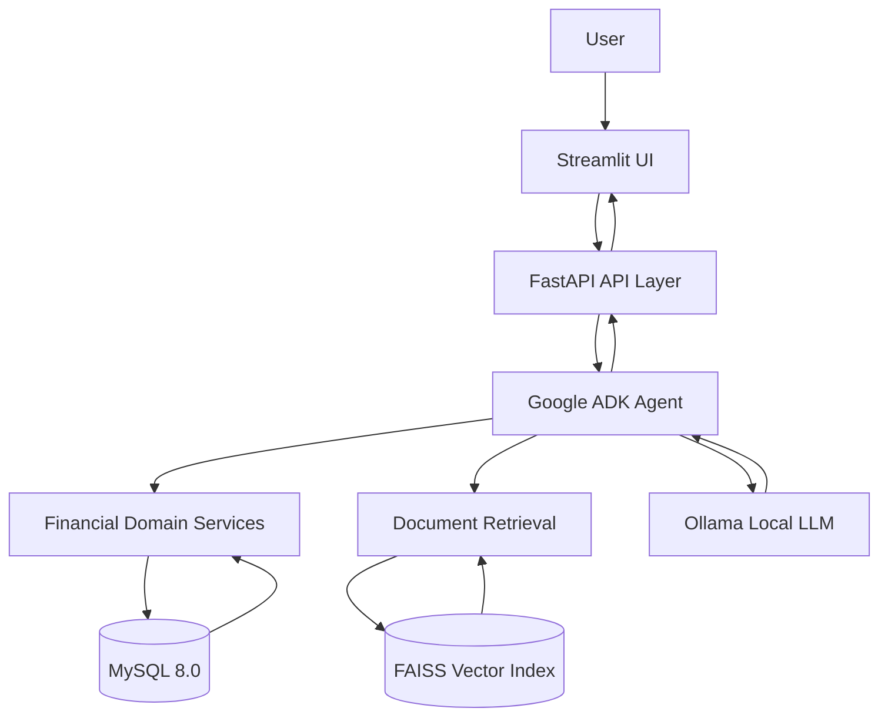

# CFO Copilot
### Self-Hosted AI Financial Assistant

CFO Copilot is a locally hosted financial assistant that combines deterministic financial calculations, Retrieval-Augmented Generation (RAG), Google ADK agent orchestration and local LLM inference.

It helps users retrieve financial KPIs, understand financial filings and receive evidence-backed answers without depending on hosted LLM inference.

The supplied financial dataset is fictional and intended for assignment evaluation.

---

## 1. Key Features

- MySQL-backed financial data storage.
- Deterministic KPI calculations outside the language model.
- Financial unit normalization for USD, USD thousands and USD millions.
- Canonical KPI aliases and source-row traceability.
- Filing amendment selection policy.
- FAISS-based semantic document retrieval.
- Company, fiscal year and fiscal quarter retrieval filters.
- Google ADK agent orchestration and tool routing.
- Local LLM inference through Ollama.
- FastAPI versioned endpoints.
- Server-Sent Events (SSE) streaming.
- Request validation, request IDs and standardized error handling.
- Bounded request concurrency and queue handling.
- Security and prompt-injection regression tests.
- Automated financial, API, retrieval and agent evaluation artifacts.

---

## 2. Architecture



### Technology Stack

| Component | Technology |
|---|---|
| Language | Python |
| UI | Streamlit |
| API | FastAPI |
| Agent orchestration | Google ADK |
| Database | MySQL 8.0 |
| Vector search | FAISS |
| Embeddings | Sentence Transformers |
| Local inference | Ollama |
| Models evaluated | Qwen 2.5 1.5B, Llama 3.2 1B |
| Containers | Docker Compose |
| Testing | Pytest and evaluation scripts |

---

## 3. Application Architecture

The application separates presentation, API handling, agent orchestration, business logic, inference and data access.

- **Presentation:** Streamlit provides the user interface.
- **API:** FastAPI validates requests and exposes versioned endpoints.
- **Agent:** Google ADK coordinates tools and question routing.
- **Business logic:** Python services perform financial calculations and validation.
- **Data:** MySQL stores structured financial information.
- **Retrieval:** FAISS searches embedded financial document chunks.
- **Inference:** Ollama serves the locally hosted language model.

Financial arithmetic is handled deterministically rather than delegated to free-form LLM generation.

---

## 4. Quick Start

### Prerequisites

- Windows, Linux or macOS.
- Docker Desktop or Docker Engine with Compose.
- Ollama installed on the host.
- A supported local model pulled into Ollama.
- Internet connection for initial dependency and Docker image downloads.
- Minimum 8 GB RAM recommended.

The current Docker configuration uses `llama3.2:1b` through Ollama.

### Set Up the Local LLM

Pull the configured model if it is not already available:

```bash
ollama pull llama3.2:1b
```

Verify that the model is available:

```bash
ollama list
```

Start Ollama before starting the application.

### Configure Environment Variables

Create your local environment file:

```powershell
Copy-Item .env.example .env
```

Update the MySQL credentials and application configuration in `.env`.

**Security:** Never commit your actual `.env` file to GitHub.

### Start the Application

From the project root, run:

```bash
docker compose up --build -d
```

This builds the application image and starts the MySQL, FastAPI and Streamlit services.

### Verify Container Status

```powershell
docker compose ps
```

### Verify Backend Health

```powershell
Invoke-RestMethod http://localhost:8001/api/v1/health
```

Expected response:

```json
{
  "status": "ok",
  "database_initialized": true
}
```

### View Application Logs

View logs for all services:

```powershell
docker compose logs -f
```

To view individual service logs:

```powershell
docker compose logs -f api
docker compose logs -f ui
docker compose logs -f mysql
```

### Access the Services

| Service | Address |
|---|---|
| Streamlit UI | [http://localhost:8501](http://localhost:8501) |
| API health | [http://localhost:8001/api/v1/health](http://localhost:8001/api/v1/health) |
| API documentation | [http://localhost:8001/docs](http://localhost:8001/docs) |

The API container listens on port 8000 internally and is mapped to host port 8001.

The Streamlit container communicates with the API using the internal Docker service address.

### Initialize Financial Data

1. Open the Streamlit interface.
2. Use the Initialize / ingest data option in the sidebar.
3. Load the Candidate Pack and Drop 2 datasets.
4. Submit a company and reporting-period question.

### Stop the Application

```bash
docker compose down
```

The MySQL database uses a persistent Docker volume named `mysql_data`.

**Warning:** Do not use `docker compose down -v` unless you intentionally want to delete the database volume and its stored data.

### Important Deployment Notes

- MySQL, FastAPI and Streamlit run inside Docker containers.
- Ollama runs separately on the host machine.
- The API connects to Ollama using `http://host.docker.internal:11434`.
- The default model is `llama3.2:1b`.
- MySQL data is stored in the persistent `mysql_data` Docker volume.
- Running `docker compose down` preserves database data.
- **Never run `docker compose down -v` unless you intentionally want to delete the database volume.**

### Troubleshooting

| Issue | Solution |
|---|---|
| Docker not starting | Start Docker Desktop. |
| MySQL connection failure | Check `.env` credentials and container health. |
| Ollama connection failure | Ensure Ollama is running on the host. |
| Model not found | Run `ollama pull llama3.2:1b`. |
| API unavailable | Check `docker compose logs api`. |
| Port conflict | Check ports 3307, 8001 and 8501. |

---

## 5. Financial Data and KPI Processing

The financial data layer supports:

- Company and filing metadata.
- Financial statement line items.
- Canonical KPI mapping.
- Unit normalization.
- Deterministic KPI calculations.
- Source-row traceability.
- Amended filing handling.
- Missing-input validation.

### Filing Amendment Policy

The financial data layer prioritizes the latest applicable filing date for a canonical line item within a company and fiscal period.

Source row IDs are retained so selected values can be traced to their underlying records.

Regression tests cover NWI FY2024 Q3 amendment behavior, amended gross margin and year-over-year calculations.

Missing or unsupported values are not silently invented.

---

## 6. RAG Pipeline

The document retrieval pipeline uses:

- `sentence-transformers/all-MiniLM-L6-v2`
- 384-dimensional embeddings.
- FAISS `IndexFlatIP`.
- Document chunking and semantic similarity search.
- Company and reporting-period filters.

The pipeline retrieves relevant document chunks that can provide context for filing-related questions.

Retrieval relevance is evaluated separately from final-answer correctness.

---

## 7. Agent Routing

The agent selects processing paths according to the question.

| Question | Expected route |
|---|---|
| Structured financial KPI | Financial data tools |
| Filing explanation | Document retrieval |
| Mixed question | Financial tools and retrieval |
| Missing evidence | Withhold unsupported claims |
| Security-sensitive request | Security policy |

The agent evaluation scripts capture tool calls, tool responses, final responses and execution information.

Recorded LLM response events should not be interpreted as exact provider API call counts.

---

## 8. API and Reliability

The API is organized under `/api/v1`.

The project includes:

- Health and application endpoints.
- Financial ingestion and company/KPI endpoints.
- Chat request handling.
- Request validation and request identifiers.
- Standardized error responses.
- SSE streaming support.
- Bounded concurrency and queue handling.
- Overload responses with retry guidance.

The exact endpoint schemas can be inspected through the FastAPI documentation at `/docs`.

---

## 9. Security

Security-related implementation and tests address:

- Prompt-injection attempts.
- Untrusted user input.
- Untrusted retrieved document content.
- Unsupported financial claims.
- Unauthorized tool behavior.
- Protection against exposing internal instructions and secrets.

Security regression tests check that malicious input does not replace supported deterministic KPI processing.

Tenant authorization, read-only database permissions and complete cross-tenant isolation must be verified before production deployment.

---

## 10. Testing

Run the test suite inside the API container:

```bash
docker compose exec api pytest -q
```

The project test suite includes coverage for:

- Financial unit normalization.
- KPI aliases and calculations.
- Amended filing selection.
- Source-row traceability.
- Missing financial inputs.
- Chat API validation.
- Request IDs and standardized errors.
- Queue and overload behavior.
- Security regression cases.
- SSE streaming.

Agent and retrieval evaluations are available separately under `evals/`.

---

## 11. Evaluation and Benchmark Results

The project contains separate evaluation artifacts for retrieval, API behavior, agent routing, security and local model runtime.

### Retrieval Evaluation

- 77 documents.
- 152 chunks.
- 21 evaluation cases loaded.
- 18 cases scored.
- Recall@5: 55.56%.
- MRR@5: 0.3833.

The metadata-based relevance score is not proof of financial answer correctness.

### Agent Evaluation

Recorded project evaluation results include:

- Qwen 2.5 1.5B: 41/41 development trajectories executed.
- Qwen route checks: 21/21 matched.
- Security adversarial cases: 20, with zero tool invocations.
- Held-out security cases: 5/5 safely blocked.
- Llama 3.2 1B: 41/41 trajectories executed, with 17/21 route checks matched.

### API Benchmark

The local sequential API benchmark contains 40 requests across four endpoint categories.

The chat endpoint showed substantial latency variability, and these results are not production load-test measurements.

### KV-Cache Limitations

The current benchmark artifacts do not establish measured TTFT, tokens per second, KV-cache hit rate or actual KV-cache memory consumption.

The required controlled three-configuration KV-cache experiment at concurrency levels 1, 4 and 16 remains a separate benchmarking requirement.

See:

- `BENCHMARK_REPORT.md`
- `CACHE_DIAGNOSIS.md`
- `DECISIONS.md`
- `LEVEL1_BLUEPRINT.md`

---

## 12. Project Documentation

| Document | Purpose |
|---|---|
| `LEVEL1_BLUEPRINT.md` | Architecture, request flow, latency budget and production risks |
| `DECISIONS.md` | Engineering decisions, experiments and lessons |
| `BENCHMARK_REPORT.md` | Retrieval, API and agent benchmark results |
| `CACHE_DIAGNOSIS.md` | KV-cache diagnosis and remaining measurements |

---

## 13. Project Limitations and Future Work

The following areas require additional verification or measurement:

1. Three-level KV-cache benchmarking.
2. TTFT and generation throughput measurements.
3. KV-cache memory and hit-rate instrumentation.
4. Controlled concurrency testing at 1, 4 and 16 users.
5. Complete tenant-isolation verification.
6. Read-only SQL permission verification.
7. Reproducible model, prompt and retrieval snapshot logging.
8. Improved retrieval relevance and evidence-sufficiency evaluation.

These limitations are explicitly distinguished from implemented application functionality.

---

## 14. Engineering Principle

CFO Copilot follows one central principle:

**Financial answers must be supported by traceable evidence, deterministic calculations and controlled AI orchestration.**

The project demonstrates how a small locally hosted model can be integrated into a structured financial application while keeping critical business logic outside the model.

---

**Project:** CFO Copilot  
**Category:** Self-Hosted GenAI / Financial AI  
**Environment:** Local development and evaluation