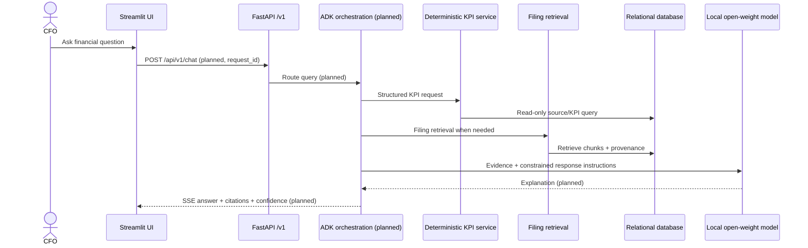

# Architecture Blueprint (initial)

## Latency budget (targets, not measurements)

| Stage | Initial budget |
|---|---:|
| Queue admission / request validation | 50 ms |
| Deterministic routing + KPI SQL | 100 ms |
| Retrieval | 250 ms |
| Local model prefill to first token | 1,200 ms |
| Network/UI overhead | 150 ms |
| Total target | 1,750 ms |

The under-2-second p95 TTFT requirement must be benchmarked on the actual target GPU and serving engine. The table is a budget allocation, not measured performance. 8,192-token contexts and 16 concurrent sessions make this a high-risk target.

## Top five production risks

1. 6 GB VRAM pressure from model weights, runtime, activations and KV cache at 16 sessions.
2. Incorrect financial figures from aliases, unit/sign normalization, missing rows or amended filings.
3. Cross-tenant data leakage through retrieval, conversation context, logs or prefix cache.
4. Prompt injection in user messages and filing text causing unsafe tool use or data disclosure.
5. Retrieval/model failures, queue saturation or timeouts causing hung or misleading answers.

## Status

The diagram includes planned components explicitly; they must not be presented as implemented until their code and tests exist.
